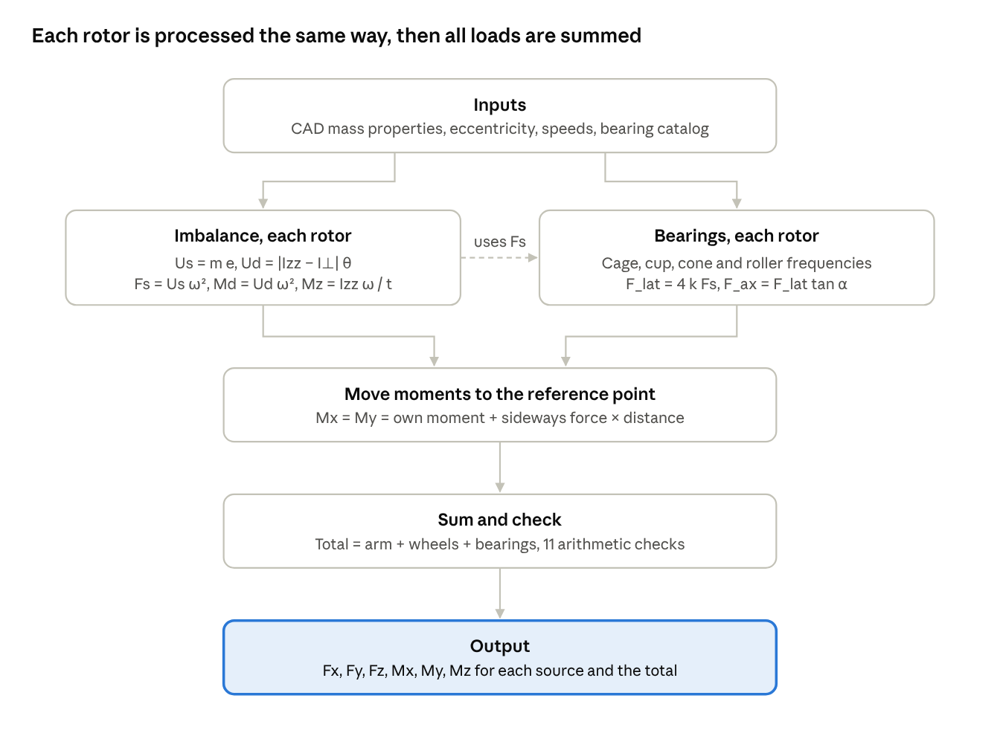

# Induced Vibration from Rotating Machinery: Fundamentals and a Preliminary Load Method for a Momentum Wheel and Rotating Arm Assembly

## Abstract

Any machine with spinning parts pushes on the structure that holds it. The pushes are small, but they repeat with every revolution, and in precision systems they can be large enough to disturb pointing, blur sensors, or excite structural modes. These loads are known as induced vibration, and estimating them is a routine part of designing anything that carries rotating hardware.

The first part of this paper covers the fundamentals in general terms. It explains where induced loads come from, the physics and equations behind each source, how loads are described in a coordinate system, and how the field normally characterizes them before and after hardware exists.

The second part applies those ideas to our assembly, which consists of two momentum wheels and a rotating arm, each on its own stationary shaft with a pair of tapered roller bearings. With no test data available, a purely analytical method was developed that estimates the six load components Fx, Fy, Fz, Mx, My and Mz from CAD mass properties, the eccentricity specification, the operating speeds and the bearing catalog. The paper describes the model, the choices made along the way and the reasons for them, and what the method does not cover. The resulting loads are conservative, hard-mounted estimates intended for early design, and they are meant to be refined as balance data, supplier data and test results become available.

## 1. Introduction

Rotating hardware such as momentum wheels, gimbals, pumps and cryocoolers shakes whatever it is attached to. This is called induced vibration. Even a rotor built to drawing and balanced to specification passes small forces and moments into its mount on every revolution, because no part is made perfectly: its center of mass sits slightly off the axis, it sits slightly crooked on its shaft, and its bearings and motor are not perfectly smooth. The loads are small, but they repeat at fixed frequencies, and near a structural resonance they can be amplified into jitter, sensor noise or fatigue. Because their size and frequency are set early by choices about speeds, balance tolerances and bearings, they need to be understood early in the design.

Our assembly contains two momentum wheels and a rotating arm, each on its own stationary shaft with tapered roller bearings and its own motor. The wheels spin opposite to the arm to cancel its angular momentum. The task was to determine the forces and moments these parts induce, including the bearing disturbances at harmonics of the arm and wheel speeds, before any hardware existed. The only inputs were CAD mass properties, the specified center of mass offsets, the operating speeds and profile, and bearing catalog data. This paper develops a method that estimates the resulting source loads, Fx, Fy, Fz, Mx, My and Mz, from that data alone, as they would act on a rigid mount.

Section 2 describes the sources of induced vibration and the equations behind each one. Section 3 describes our assembly, Section 4 defines the coordinate system and the loads, and Section 5 lists the model inputs. Section 6 sets out the model equations as applied to our assembly, and Section 7 explains the analysis method and the reasoning behind it. Section 8 covers assumptions and limitations, and Section 9 gives next steps and conclusions.

## 2. Induced Vibration Fundamentals

### 2.1 Where induced loads come from

A rigid body can only push on its supports with a force or a moment. Newton's second law says it needs a net force whenever its center of mass accelerates, and Euler's equation says it needs a net moment whenever its angular momentum changes in size or direction:

$$\mathbf{F} = m\,\mathbf{a}_{cm}$$ {#newton}

$$\mathbf{M} = \frac{d\mathbf{H}}{dt}$$ {#euler}

A perfectly made rotor spinning at constant speed about one of its principal axes does neither. Its center of mass sits still on the axis, and its angular momentum points steadily along the shaft, so it transmits nothing to its mount beyond its own weight.

Real rotors fall short of that ideal in several ways, and each shortfall becomes a source of induced vibration. The rotor itself can be out of balance, either statically or dynamically. Its bearings can be imperfect. Its motor can deliver torque unevenly. Random processes inside the bearings and electronics can add noise. And if the rotor's mount is itself turning, the rotor's angular momentum produces gyroscopic moments. The sections below describe each of these in turn. Throughout, Ω is the spin rate in rad/s, N is the same speed in rev/min, and f_r is the rotor frequency in Hz:

$$\Omega = \frac{2\pi N}{60}$$ {#omega}

$$f_r = \frac{N}{60} = \frac{\Omega}{2\pi}$$ {#fr}

### 2.2 Static imbalance

Static imbalance exists when the center of mass of a rotor does not lie on its axis of rotation. As the rotor turns, its center of mass is carried around a small circle on every revolution. Keeping a mass on a circular path requires a force toward the center, and the only thing that can supply it is the shaft. The rotor pulls back on the shaft with an equal force directed outward toward its heavy side.

The size of the effect is set by the product of the rotor mass m and the offset e of its center of mass, a quantity called the static imbalance U_s. Since the center of mass accelerates toward the axis at eΩ², Equation (@newton) gives the force on the mount:

$$U_s = m\,e$$ {#us}

$$F_s = U_s\,\Omega^2$$ {#fs}

The force rotates with the rotor and repeats once per revolution. Because it grows with the square of the spin rate, it is small at low speed and becomes the dominant source in most rotating machinery at operating speed.

Static imbalance gets its name because it can be detected without spinning anything. A statically unbalanced wheel set on frictionless rails will roll until its heavy side is at the bottom. It is corrected by adding or removing mass in a single plane.

The acceptable amount of static imbalance is usually set by a balance quality grade under ISO 21940. The grade number G is the product of the allowed center of mass offset and the operating angular speed:

$$G = e\,\Omega \quad [\mathrm{mm/s}]$$ {#grade}

Precision spindles and gyroscopes are commonly balanced to G 1 or better, while general industrial machinery is often balanced to G 6.3. Because the grade ties the offset to the speed, faster rotors must be balanced more tightly to achieve the same grade.

### 2.3 Dynamic imbalance

A rotor can have its center of mass exactly on the shaft and still shake. If its principal axis of inertia is tilted slightly from the spin axis, the rotor's angular momentum no longer lines up with the shaft. As the rotor turns, the angular momentum sweeps around a narrow cone, and by Equation (@euler) changing its direction in this way requires a moment. The shaft supplies it, and the rotor pushes back with a rocking moment that rotates with it, once per revolution.

This is dynamic imbalance, sometimes called couple imbalance. For a small tilt θ, it depends on the difference between the inertia about the spin axis, I_zz, and the inertia about the sideways axis the rotor is tilted toward, I_⊥:

$$U_d = \left|I_{zz} - I_{\perp}\right|\,\theta$$ {#ud}

$$M_d = U_d\,\Omega^2$$ {#md}

The inertia difference governs how strongly a rotor responds to a tilt. A flat disc, whose spin inertia is about twice its sideways inertia, produces a noticeable moment from a small tilt. A body with equal inertias in every direction produces none, however it is tilted. Long, slender rotors such as arms and booms can have very different inertias about their two sideways axes. When the direction of the tilt is not known, the larger of the two differences gives an upper bound:

$$U_{d,\mathrm{max}} = \max\left(\left|I_{zz}-I_{xx}\right|,\ \left|I_{zz}-I_{yy}\right|\right)\theta$$ {#udmax}

Dynamic imbalance only shows itself when the rotor spins, which is where the name comes from. Correcting it requires balancing in two planes along the rotor.

| | Static imbalance | Dynamic imbalance |
|---|---|---|
| Physical cause | Center of mass off the spin axis | Principal axis tilted from the spin axis |
| Measure | U_s = m e | U_d = \|I_zz − I_⊥\| θ |
| Load on the structure | Rotating sideways force | Rotating rocking moment |
| Load components | Fx, Fy | Mx, My |
| Frequency | Once per revolution | Once per revolution |
| Detectable at rest | Yes | No |
| Corrected by | Single-plane balancing | Two-plane balancing |

Real rotors almost always carry both kinds at once. They come from different manufacturing errors, so the angle between the heavy spot and the direction of tilt is effectively random and is rarely known before the rotor is balanced.

### 2.4 Bearing-induced vibration

Rolling element bearings are a separate source from the rotor itself. No bearing is perfectly smooth or perfectly round. Its races have small waves and high spots, its rolling elements are not all exactly the same size, and its cage does not run perfectly true. Each time a rolling element passes over one of these imperfections, the bearing gives the structure a small kick.

The timing of these kicks is fixed by the bearing's geometry: the number of rolling elements Z, the element diameter D, the pitch diameter d_p and the contact angle α. For a bearing whose outer race turns with the rotor at f_r while the inner race is held still on a stationary shaft, the characteristic frequencies are:

$$f_c = \frac{f_r}{2}\left(1 + \frac{D}{d_p}\cos\alpha\right)$$ {#fcage}

$$f_{o} = \frac{Z f_r}{2}\left(1 - \frac{D}{d_p}\cos\alpha\right)$$ {#fouter}

$$f_{i} = \frac{Z f_r}{2}\left(1 + \frac{D}{d_p}\cos\alpha\right)$$ {#finner}

$$f_b = \frac{d_p}{2D}\,f_r\left[1 - \left(\frac{D}{d_p}\cos\alpha\right)^2\right]$$ {#fball}

Equation (@fcage) is the cage frequency, the rate at which the set of rolling elements travels around the bearing. Equation (@fouter) is the outer race pass frequency, the rate at which elements pass a given point on the outer race. Equation (@finner) is the inner race pass frequency, the rate at which they pass a given point on the inner race. Equation (@fball) is the rolling element spin frequency. A defect on a rolling element strikes both races once per spin, so it often appears at twice f_b. When the inner race turns instead and the outer race is fixed, the sign inside the cage frequency changes, giving (f_r/2)(1 − (D/d_p) cos α), while the two race pass frequencies and the spin frequency are unchanged. Two identities hold in either case and make useful checks:

$$f_o + f_i = Z f_r$$ {#idsum}

$$f_o = Z\left(f_r - f_c\right)$$ {#idcage}

None of these frequencies is a whole multiple of the shaft speed, which is how bearing disturbances are told apart from imbalance in measured spectra.

The frequencies can be calculated exactly from catalog data. The size of the disturbances cannot, since it depends on surface finish, roundness, preload, lubrication and wear, and in practice it is measured. In tapered roller bearings and other angular contact bearings, the rolling elements sit at the contact angle, so each lateral kick F_lat also has a component along the shaft:

$$F_{ax} = F_{lat}\tan\alpha$$ {#fax}

Bearings with a contact angle are therefore one of the few sources of axial force in a rotating assembly.

### 2.5 Motor-induced vibration

The motor that drives a rotor produces its own disturbances, all of them acting mainly as twisting moments about the spin axis.

The largest is the reaction torque during speed changes. To accelerate the rotor, the motor applies a torque to it, and the motor's stator, which is fixed to the structure, receives the same torque in the opposite direction. For a rotor accelerating at Ω̇, the torque on the mount is:

$$T = -\,I_{zz}\,\dot{\Omega}$$ {#torque}

For a constant ramp from rest to Ω in time t, the acceleration is simply:

$$\dot{\Omega} = \frac{\Omega}{t}$$ {#ramp}

This load lasts only as long as the speed is changing, but it can be much larger than the vibratory loads. In assemblies with several rotors, the rotors can be arranged to spin in opposite directions so that their reaction torques cancel.

A speed change also gives the static imbalance a small tangential component, U_s Ω̇. Compared with the centripetal force of Equation (@fs), its size is:

$$\frac{F_t}{F_s} = \frac{U_s\,\dot{\Omega}}{U_s\,\Omega^2} = \frac{1}{\Omega\,t}$$ {#tangential}

For ramps lasting several seconds this ratio is well under 1%, so the term is usually neglected.

On top of the reaction torque, motors produce small periodic variations in their output. Torque ripple comes from the way current is switched between windings. Cogging comes from the magnets being attracted to the steel teeth of the stator. For a three-phase motor with p pole pairs and N_s stator slots, they occur at:

$$f_{\mathrm{ripple}} = 6\,n\,p\,f_r$$ {#ripple}

$$f_{\mathrm{cog}} = n\,\mathrm{LCM}\left(N_s,\,2p\right) f_r, \qquad n = 1, 2, 3, \ldots$$ {#cog}

Both frequencies can be predicted from the motor's design, but their amplitudes depend on the specific motor and are taken from datasheets or tests. An off-center rotor inside the motor can also create small radial magnetic forces.

### 2.6 Broadband noise

Not all induced vibration falls at distinct frequencies. Surface roughness in the bearings, irregular motion of the cage, lubricant behavior and switching in the drive electronics all produce random disturbances spread across a wide frequency range. This is broadband noise. It cannot be described by an amplitude at a single frequency, so it is characterized statistically by a power spectral density S(f). The root-mean-square load over a band follows from its integral:

$$F_{\mathrm{rms}} = \sqrt{\int_{f_1}^{f_2} S_F(f)\,df}$$ {#rms}

Broadband noise has no deterministic cause that can be modeled from a drawing. It is measured on the finished hardware. For well-balanced rotors in good bearings it is generally small compared with the discrete disturbances, but in very quiet systems, or between the discrete lines of a spectrum, it can set the noise floor.

### 2.7 Gyroscopic effects

A spinning rotor carries angular momentum along its spin axis:

$$\mathbf{H} = I_{zz}\,\Omega\,\hat{\mathbf{z}}$$ {#h}

If the structure it is mounted to rotates at a rate ω_s about a different axis, the direction of that angular momentum is forced to change, and the rotor resists with a gyroscopic moment on its mount:

$$\mathbf{M}_{\mathrm{gyro}} = -\,\boldsymbol{\omega}_s \times \mathbf{H}$$ {#gyro}

Gyroscopic moments are therefore not a vibration of the rotor itself but an interaction between the rotor and the motion of whatever carries it. On a fixed base, ω_s is zero and so is the moment. On a spacecraft that slews, or a platform that tilts, it can be large. For several rotors, the moment depends on their total angular momentum, so rotors that spin in opposite directions with equal momentum largely cancel it:

$$\mathbf{H}_{\mathrm{total}} = \sum_i I_{zz,i}\,\Omega_i\,\hat{\mathbf{z}} \approx \mathbf{0}$$ {#htotal}

Gyroscopic effects also change the dynamics of the rotor on its bearings. A spinning rotor's rocking modes split into a forward whirl that stiffens with speed and a backward whirl that softens, which moves the speeds at which a disturbance can excite a resonance. This matters mainly for the structural analysis rather than for the source loads themselves.

### 2.8 Speed scaling and combining sources

Imbalance loads, and bearing loads that are tied to them, grow with the square of the speed. A load L known at one speed can therefore be found at any other:

$$L(N) = L_{\mathrm{ref}}\left(\frac{N}{N_{\mathrm{ref}}}\right)^2$$ {#scaling}

Loads from separate sources add by superposition. When the phases between them are unknown, adding their peak values gives an upper bound on the combined load:

$$L_{\mathrm{total}} \le \sum_i L_i$$ {#superposition}

### 2.9 Summary of sources

| Source | Main loads | Frequency | Size predictable from design data? |
|---|---|---|---|
| Static imbalance | Fx, Fy | Once per revolution | Yes, from mass and eccentricity |
| Dynamic imbalance | Mx, My | Once per revolution | Yes, from inertias and tilt |
| Bearings | Fx, Fy, and Fz for angular contact bearings | Fixed non-integer multiples of shaft speed | Frequencies yes; amplitudes no |
| Motor reaction torque | Mz | During speed changes | Yes, from spin inertia and ramp time |
| Motor ripple and cogging | Mz | Multiples set by pole and slot counts | Frequencies yes; amplitudes from datasheet or test |
| Broadband noise | All components | Spread across a wide range | No, measured only |
| Gyroscopic effects | Mx, My | Follows motion of the mount | Yes, if the mount's motion is known |

### 2.10 How induced loads are characterized in practice

The loads a machine passes into its surroundings depend partly on the machine and partly on what it is attached to. A soft mount lets the machine move, and a mount with a resonance near an operating frequency can amplify the loads. To keep the machine's own contribution separate, induced loads are normally defined as if the machine were bolted to a perfectly rigid base. These are called hard-mounted or blocked loads. They can be handed to any structural model, which then adds its own stiffness and damping to find the response, and they are also how hardware is tested: rotating units are mounted on a stiff force and moment table that records the six interface loads.

Before hardware exists, the loads are estimated analytically. The imbalance terms can be predicted from mass properties and balance requirements with good confidence, and bearing and motor frequencies can be predicted exactly from geometry. The sizes of the bearing, motor and broadband disturbances cannot be predicted reliably and are added once test data is available. A widely used way of describing measured rotor disturbances is the empirical model developed for reaction wheels by Masterson, Miller and Grogan, in which each load is a sum of harmonics of the spin rate:

$$F(t) = \sum_i C_i\,\Omega^2\sin\left(2\pi h_i f_r t + \phi_i\right)$$ {#masterson}

Here h_i is the harmonic number of each line, C_i its amplitude coefficient and φ_i its phase. The fundamental, h = 1, is the imbalance, with C equal to U_s for the force or U_d for the moment. The other lines come from bearings, motors and other imperfections, and their coefficients are fitted from test data.

A complete assessment moves from source loads, to refinement with supplier and test data, to a structural response analysis, to verification by test. This paper covers the first stage.

## 3. System Description

The assembly has three rotating parts arranged along a common line: a first momentum wheel, a rotating arm, and a second momentum wheel. Each turns on its own stationary shaft and is supported by a pair of tapered roller bearings mounted back to back. The outer race of each bearing, the cup, turns with the rotating part, while the inner race, the cone, is fixed to the shaft. Each part has its own drive motor.

The arm is a long, slender body whose length runs perpendicular to its shaft. It turns about the shaft axis through complete revolutions, behaving like a seesaw that keeps going around rather than rocking back and forth. Because it is long and narrow, its inertia is very different about its two transverse axes, which matters for its dynamic imbalance.

The two momentum wheels spin in the opposite direction to the arm and at a higher speed. Their purpose is to cancel the arm's angular momentum, so that the assembly as a whole does not exchange momentum with its mount when the parts speed up or slow down. The wheel speeds therefore track the arm speed at a fixed ratio.

All three parts follow the same operating profile: a spin-up from rest to a hold speed, a period at constant speed, and a spin-down back to rest. The imbalance and bearing loads are largest during the hold, at maximum speed. The reaction torques from the motors act only during the spin-up and spin-down.

## 4. Coordinate System and Load Definitions

### 4.1 Reference frames

Two frames of reference are useful when describing induced vibration. The rotor frame is attached to the spinning part and turns with it. In this frame an imbalance is fixed: the heavy spot and the tilt always point in the same direction. The structure frame is attached to the mount and does not turn. This is the frame in which the structure feels the loads, and it is the frame in which induced loads are always reported.

Both frames are right-handed. By convention the z axis is placed along the spin axis, with x and y perpendicular to it. Positive rotation about z follows the right-hand rule, and a rotor turning the opposite way is given a negative spin rate. Loads are defined as those applied by the rotating machine onto its mount.

### 4.2 The six load components

Any set of loads that a machine applies to its mount can be reduced to three forces and three moments at a chosen point, written as a single six-component load vector:

$$\mathbf{d} = \begin{bmatrix} F_x & F_y & F_z & M_x & M_y & M_z \end{bmatrix}^T$$ {#dvec}

| Component | Direction | Common name | Typical sources |
|---|---|---|---|
| Fx, Fy | Perpendicular to the spin axis | Lateral or radial forces | Static imbalance, bearings |
| Fz | Along the spin axis | Axial force | Angular contact bearings, axial harmonics |
| Mx, My | About axes perpendicular to the spin axis | Rocking moments | Dynamic imbalance, lateral forces acting at a distance |
| Mz | About the spin axis | Torque or twist | Motor reaction torque, torque ripple, cogging |

### 4.3 Reference point and load transfer

Forces are the same at every point of a rigid body, but moments depend on where they are taken. Induced loads are therefore always stated at a named reference point, usually the mounting interface where the machine attaches to the rest of the system. If a force F and a moment M act at a point P, the moment about the reference point is found by adding the moment of the force about that point:

$$\mathbf{M}_{\mathrm{ref}} = \mathbf{M}_P + \left(\mathbf{r}_P - \mathbf{r}_{\mathrm{ref}}\right)\times\mathbf{F}$$ {#transfer}

This is how loads produced at a rotor's center of mass are moved to an interface, and how a set of loads reported at one point can be restated at another. The transfer should be made once, directly from the point where the load acts to the reference point. Moving a load in two steps, first to an intermediate mount and then to the reference point, is equivalent only if the second step starts from the intermediate point and not from the original one; otherwise the same lever arm is counted twice.

### 4.4 Several rotors and rotated axes

When a machine has more than one rotor, each rotor's loads are first found in its own frame, with z along its own spin axis. If the spin axes are not aligned with the structure axes, each rotor's forces and moments are rotated into the structure frame with a direction cosine matrix R before they are moved to the reference point and added:

$$\mathbf{F}_{\mathrm{struct}} = \mathbf{R}\,\mathbf{F}_{\mathrm{rotor}}$$ {#rotf}

$$\mathbf{M}_{\mathrm{struct}} = \mathbf{R}\,\mathbf{M}_{\mathrm{rotor}}$$ {#rotm}

When all the spin axes are parallel to the structure z axis, R is the identity matrix and the loads can be added directly.

### 4.5 Rotating loads in a fixed frame

A load that is constant in the rotor frame, such as the force from a static imbalance, rotates when seen from the structure frame. Its x and y components rise and fall in turn, each reaching the same peak but a quarter of a revolution apart, and the resultant at any instant equals that peak:

$$F_x(t) = F\cos(\Omega t + \phi)$$ {#fxt}

$$F_y(t) = F\sin(\Omega t + \phi)$$ {#fyt}

$$\sqrt{F_x^2 + F_y^2} = F$$ {#resultant}

For this reason, rotating loads are usually reported as peak amplitudes for each component. Fx and Fy are listed separately because a structural model needs both directions, but they should not be combined as if they happened at the same time, which would overstate the resultant by a factor of √2. The same applies to Mx and My. Where loads from several sources with unknown relative phase are combined, adding their peaks gives the upper bound of Equation (@superposition).

## 5. Model Inputs

The analysis was carried out before any hardware was built, so every input comes from design data, specifications or catalogs. No balance reports, bearing vibration data or test measurements were available. The CAD models are symmetric, so on their own they show no imbalance at all. The real imbalance comes from manufacturing and assembly tolerances, which is why the eccentricity specification, rather than the CAD geometry, sets the static imbalance.

### 5.1 Inputs for each rotating part

The same set of inputs is supplied separately for each wheel and for the arm.

| Input | Symbol | Units | Source |
|---|---|---|---|
| Rotating mass | m | kg | CAD mass properties |
| Center of mass offset (eccentricity) | e | µm | Eccentricity specification |
| Transverse moments of inertia, at the center of mass | I_xx, I_yy | kg·m² | CAD mass properties |
| Spin moment of inertia | I_zz | kg·m² | CAD mass properties, or from stored momentum |
| Stored angular momentum (alternative to I_zz) | H | N·m·s | Datasheet, when given |
| Tilt of the principal axis from the shaft | θ | deg | Estimate |
| Static imbalance (optional) | U_s | kg·m | Balance specification, when available |
| Dynamic imbalance (optional) | U_d | kg·m² | Balance specification, when available |
| Maximum (hold) speed | N | rev/min | Operating requirement |
| Spin direction | ±1 | – | Design |
| Position of the center of mass along the shaft | z | m | CAD |

### 5.2 Bearing inputs

Each rotating part has its own pair of tapered roller bearings. Their geometry comes from the manufacturer's catalog for the selected part number.

| Input | Symbol | Units | Source |
|---|---|---|---|
| Number of rolling elements | Z | – | Bearing catalog |
| Rolling element (mean roller) diameter | D | mm | Bearing catalog |
| Pitch diameter | d_p | mm | Bearing catalog |
| Contact (cup) angle | α | deg | Bearing catalog |
| Bearing kick ratio | k | – | Estimate (1%) |

### 5.3 Operating and reporting inputs

| Input | Symbol | Units | Source |
|---|---|---|---|
| Spin-up time | t_up | s | Motor control profile |
| Spin-down time | t_down | s | Motor control profile |
| Reference point position | z_ref | m | Mounting interface location |
| Other speeds of interest | – | rev/min | As requested |

### 5.4 Calculated, estimated and optional inputs

Most inputs are taken directly from CAD, specifications or catalogs. Two are estimates. The tilt θ has no specified tolerance, so a small value consistent with ordinary machining and assembly practice is used. The bearing kick ratio k stands in for bearing vibration data, which can only come from the supplier or a test.

Static and dynamic imbalance can be supplied in two ways. If they are left blank, they are calculated from the other inputs using Equations (@us) and (@udmax). If a balance specification or report gives them directly, those values are entered instead and take priority. Entering U_d this way removes the need for the tilt estimate. Similarly, where a datasheet gives the stored angular momentum rather than the spin inertia, I_zz follows from Equation (@izzh) in Section 6.

## 6. Model Equations

This section applies the fundamentals of Section 2 to the three rotating parts of our assembly. Every part is handled with the same equations; the subscript w is used below for a momentum wheel and the same expressions apply to the arm.

### 6.1 Speed and inertia

The operating speed of each part is given in rev/min and converted to rad/s and Hz. Where a datasheet gives the stored angular momentum H_w rather than the spin inertia, the inertia follows directly from it:

$$\Omega_w = \frac{2\pi N_w}{60}, \qquad f_{r,w} = \frac{N_w}{60}$$ {#speedw}

$$I_{zz} = \frac{H_w}{\Omega_w}$$ {#izzh}

### 6.2 Imbalance loads

The vibratory loads at once per revolution come from the imbalance of each part. Static imbalance produces a lateral force and dynamic imbalance produces a rocking moment, both rotating with the part:

$$F_w = U_s\,\Omega_w^2$$ {#fw}

$$M_w = U_d\,\Omega_w^2$$ {#mw}

where U_s and U_d come from Equations (@us) and (@udmax) or from a balance specification. Both loads grow with the square of speed, so doubling the speed quadruples them. Seen from the stationary shaft, each appears on the two sideways axes as a pair of equal sinusoids, 90° apart, as in Equations (@fxt) and (@fyt).

### 6.3 Moments at the reference point

These loads act at the part's center of mass, which sits at position r_cm along the shaft. Following Equation (@transfer), they are moved directly to the reference point in a single step:

$$\mathbf{M}_{\mathrm{ref}} = \mathbf{M}_w + \left(\mathbf{r}_{cm} - \mathbf{r}_{\mathrm{ref}}\right)\times\mathbf{F}_w$$ {#mrefw}

Because the angle between the heavy spot and the direction of tilt is unknown, the two terms are added at full value. With L the distance along the shaft between the center of mass and the reference point, the peak rocking moment is:

$$M_x = M_y = M_w + F_w L, \qquad L = \left|z - z_{\mathrm{ref}}\right|$$ {#mxmy}

All shafts are parallel to the structure z axis, so no rotation of axes is needed and R in Equations (@rotf) and (@rotm) is the identity matrix.

### 6.4 Reaction torque

The wheel and the arm also produce quasi-steady loads. Changing a part's speed takes a torque, which the motor applies to the rotor and the stator passes into the shaft. From Equations (@torque) and (@ramp), spin-up and spin-down are treated separately:

$$T_{\mathrm{up}} = -\,I_{zz}\,\frac{\Omega_w}{t_{\mathrm{up}}}$$ {#tup}

$$T_{\mathrm{down}} = +\,I_{zz}\,\frac{\Omega_w}{t_{\mathrm{down}}}$$ {#tdown}

The signs show that the mount is twisted one way during spin-up and the other way during spin-down, and parts spinning in opposite directions produce opposite signs. The net twist of the assembly is the signed sum over all three parts, which the counter-rotating wheels bring close to zero.

If the support structure rotated, each part would also apply a gyroscopic moment, Equation (@gyro). Because all shafts are stationary, ω_s is zero and this moment does not arise. The tangential imbalance force of Equation (@tangential) is also neglected, since it is under 1% of the main force for the ramp times used.

### 6.5 Bearing loads

The bearing frequencies for each part follow from Equations (@fcage) to (@fball), using the outer-race-rotating forms, with f_r taken as that part's own rotor frequency. With no supplier or test data, the size of each bearing harmonic is estimated as a fraction k of the part's static imbalance force. The four harmonics are added at full value, the axial component follows from Equation (@fax), and the lateral force acting at the part's position adds a rocking moment at the reference point:

$$F_{lat} = 4\,k\,F_w$$ {#flat}

$$F_{ax} = F_{lat}\tan\alpha$$ {#faxw}

$$M_{x,brg} = M_{y,brg} = F_{lat}\,L$$ {#mbrg}

### 6.6 Assembly totals

The six components are summed over the arm, both wheels and all bearings, following Equation (@superposition). Forces and rocking moments are added as peak values. The twist is added with its sign, and its magnitude is reported as the net assembly twist. Loads at any other operating point follow from Equation (@scaling), using the arm speed, since the wheels track the arm at a fixed ratio.

| Load | Arm and each wheel | Bearings |
|---|---|---|
| Fx, Fy | F_w, Equation (@fw) | F_lat, Equation (@flat) |
| Fz | 0 | F_ax, Equation (@faxw) |
| Mx, My | M_w + F_w L, Equation (@mxmy) | F_lat L, Equation (@mbrg) |
| Mz | Larger of T_up and T_down, Equations (@tup) and (@tdown) | 0, since bearing drag is reacted inside the assembly by the motor |

## 7. Analysis Method

### 7.1 Overall approach

The method follows directly from the fundamentals in Section 2. Each rotating part is treated as a rigid rotor and examined for the three rotor effects: static imbalance, dynamic imbalance and reaction torque. The bearings under each part are then treated as a fourth source. The loads from every source are expressed as the six components Fx, Fy, Fz, Mx, My and Mz at a single reference point and added together, as set out in Section 6.

Three decisions frame everything that follows. First, the loads are hard-mounted, following the convention described in Section 2.10, so that they can be handed to a structural model without double counting the structure's response. Second, the results are peak amplitudes at the maximum operating speed, which is where imbalance loads are largest. Third, because the relative phases between sources are unknown, every peak is added as if it occurs at the same instant. Real loads will be equal to or lower than the reported values. Together these choices give an answer that is conservative, easy to check by hand, and in the form most useful at the early design stage.

All three parts are handled by the same equations and the same code. Nothing in the method is specific to wheels or arms, so it applies equally to any number of rotors on parallel shafts, provided the inputs for each are supplied.

Of the sources described in Section 2, the method includes those that can be estimated from the design data available: static imbalance, dynamic imbalance, motor reaction torque and the bearings. The remaining sources are left out for specific reasons. Motor ripple and cogging need the motor pole and slot counts and ripple data, which were not yet available. Broadband noise has no deterministic model and can only be measured. Gyroscopic moments are zero because all three shafts are stationary, and even if the assembly were carried on a moving base, the counter-rotating wheels are sized to bring its total angular momentum close to zero, as in Equation (@htotal). Each of these can be added later without changing the rest of the method.

### 7.2 Static imbalance from the eccentricity specification

Because the CAD models are symmetric, the static imbalance was taken from the eccentricity specification rather than from the geometry, using Equation (@us), and the lateral force at maximum speed follows from Equation (@fw). This force rotates with the part. It appears at the reference point as Fx and Fy, each with the same peak value, reached a quarter of a revolution apart. It produces no axial force. Once a balance specification or a balance report is available, its value of U_s replaces the one calculated from eccentricity, and the rest of the method is unchanged.

### 7.3 Dynamic imbalance from inertia and an estimated tilt

Dynamic imbalance needs two inputs: the difference between the spin and transverse inertias, which comes from CAD, and the tilt of the principal axis relative to the shaft, which was not specified. A small tilt was therefore assumed for each part, of a size consistent with ordinary machining and assembly tolerances. This is the least certain input in the imbalance calculation and is flagged as such in the results.

The direction of the tilt is also unknown. For a rotor with equal transverse inertias, such as a wheel, this does not matter. For the arm it matters a great deal, because its inertia about one transverse axis is close to its spin inertia while its inertia about the other is very small. The method therefore uses Equation (@udmax), which takes the worst tilt direction. As with static imbalance, U_d can be entered directly when a balance specification provides it, and doing so removes the need for the tilt estimate altogether.

### 7.4 Moments at the reference point

Each part's loads are moved from its center of mass to the reference point in a single step, using Equation (@mrefw), so that no lever arm is counted twice. Moving the reference point changes the moments but not the forces, which lets the same calculation report loads at whichever interface the structures team needs.

### 7.5 Twist during spin-up and spin-down

The twist about the shaft was calculated separately for spin-up and spin-down, Equations (@tup) and (@tdown), because the two ramps can have different durations. The load tables carry the larger of the two values for each part. When the twists of all three parts are added with their signs, the counter-rotating wheels largely cancel the arm, which is the purpose of the wheels. The net value is reported as the assembly's twist, but each motor mount still carries its own full torque, and those values are reported separately so that the individual mounts can be checked.

### 7.6 Bearings

The bearing calculation has two parts with very different levels of confidence. The frequencies are exact. For each part, the catalog geometry gives the cage, outer race pass, inner race pass and rolling element spin frequencies from Equations (@fcage) to (@fball). These frequencies are reported in full because they are what a structural analyst needs to check for resonance.

The amplitudes are estimated. With no supplier or test data, each bearing harmonic was assumed to produce a lateral force equal to a small fraction k of that part's static imbalance force, Equation (@flat). A value of 1% was used. Tying the bearing estimate to the imbalance force keeps it in proportion to the size and speed of the part, and keeping k as a single, clearly labeled input makes it easy to change once real data arrives. Because the rollers in a tapered bearing sit at the contact angle, each lateral kick was given an axial component as well, Equation (@faxw).

The two bearings of each back-to-back pair were treated together as a single source at the part's position. A more detailed model would place each bearing separately and account for preload, but that refinement only becomes meaningful once the amplitudes themselves are known.

### 7.7 How the method was developed

The work started from the task itself, which was to estimate the forces and moments induced by the two wheels, the arm and the bearings, using analysis alone. The first step was to identify every mechanism by which a rigid rotor on a fixed shaft can load its mount. Working from Equations (@newton) and (@euler) showed that there are only three, and that the bearings form a fourth, separate source. This gave a complete list of sources before any equations were written, and it made clear which effects could be calculated from design data and which could not.

The reference material on reaction wheel disturbance modeling was then reviewed to confirm that the same sources and the same speed-squared scaling are used in practice. It also showed how measured data is normally folded in later, which shaped the decision to keep every estimated quantity as a single, visible input that can be replaced.

The method was then built as a script, kept deliberately short so that every line could be followed and checked. It was compared with a separate, much larger set of time-domain models covering the same hardware. Those models used the same equations for every effect included here, and the additional terms they carry are either negligible for our ramp times, zero for stationary shafts, or dependent on test data we do not yet have.

An independent review of an early version raised several points about how results could be misread. In response, the output now states that Fx and Fy are peaks reached a quarter turn apart rather than simultaneous values, labels every result as a worst-case estimate, identifies which inputs are estimates, and reports spin-up and spin-down twist separately. The built-in checks are also described as checks on the arithmetic, not on the physical inputs. Among them are the bearing identities of Equations (@idsum) and (@idcage), which hold for any bearing geometry.

### 7.8 Implementation

The method is implemented in a single MATLAB script. The only part a user edits is the input section, where each rotating part has its own block of clearly named values. Static and dynamic imbalance may be left blank to be calculated, or entered directly from a balance specification. When the script runs, it calculates every source, sums the loads, runs a set of arithmetic checks, plots the lateral and axial force against speed, and prints the results in four parts followed by the loads at other speeds. The flow is shown in Figure 1.

{width=6in}

## 8. Assumptions and Limitations

The method rests on a small number of assumptions, each chosen either because it is the standard convention for source loads or because it errs toward a larger, safer answer. The parts are treated as rigid and the mount as perfectly stiff, which is the hard-mounted convention. All peaks are added as though they occur together, since the phases between sources are unknown. Fx and Fy are peak values of the same rotating force, reached a quarter turn apart, so the resultant lateral force equals Fx rather than √2 times Fx, and the same is true of Mx and My. The dynamic imbalance uses the worst tilt direction. Speed changes are taken to occur at a constant rate, and the shafts do not move in space, so there is no gyroscopic load from motion of the base.

Three inputs are estimates. The tilt of each part has no specified tolerance and was set to a small value consistent with normal machining practice; it can be removed entirely by entering U_d from a balance specification. The bearing kick ratio of 1% stands in for supplier or test data on bearing vibration. The axial bearing force is based on the contact angle alone and treats each bearing pair as one bearing, without preload.

Some effects are outside the scope of the method. It does not include structural resonance, which can raise the loads well above the hard-mounted values near a natural frequency. It does not include motor torque ripple or cogging, imbalance harmonics above the running speed, or broadband noise. It also neglects the small tangential imbalance force during speed ramps, which is under 1% of the main force for ramps of around ten seconds.

## 9. Next Steps and Conclusion

The next steps follow directly from the estimates and exclusions above. The final CAD mass properties, speeds, positions and bearing part numbers will be entered to produce the load values for our hardware. The tilt estimate will be replaced with U_d from a balance specification, and the bearing kick ratio with supplier data or a bearing test. Motor torque ripple can be added once the motor pole and slot counts and ripple data are known. The loads and the bearing frequencies will be passed to the structural analysis to check for modes close to any disturbance frequency, and once hardware is built, the assembly will be measured on a force table and compared with these estimates.

Induced vibration from rotating machinery comes down to a short list of physical effects. A rotor whose center of mass is off its axis pushes sideways. A rotor that sits tilted rocks its shaft. A rotor that changes speed twists its mount. The bearings add small kicks at frequencies set by their geometry. For our assembly, each of these was estimated from design data alone, in a form that is conservative, can be checked by hand, and can be refined one input at a time as better data becomes available.

## References

1. Masterson, R. A., Miller, D. W., and Grogan, R. L. Development and validation of reaction wheel disturbance models: empirical model. Journal of Sound and Vibration, 2002.
2. ISO 21940. Mechanical vibration: rotor balancing. International Organization for Standardization.
3. Timken. Engineering manual for tapered roller bearings.
4. Meriam, J. L., and Kraige, L. G. Engineering Mechanics: Dynamics. Wiley.
5. Reference documents provided for this task on induced vibration and disturbance modeling.
